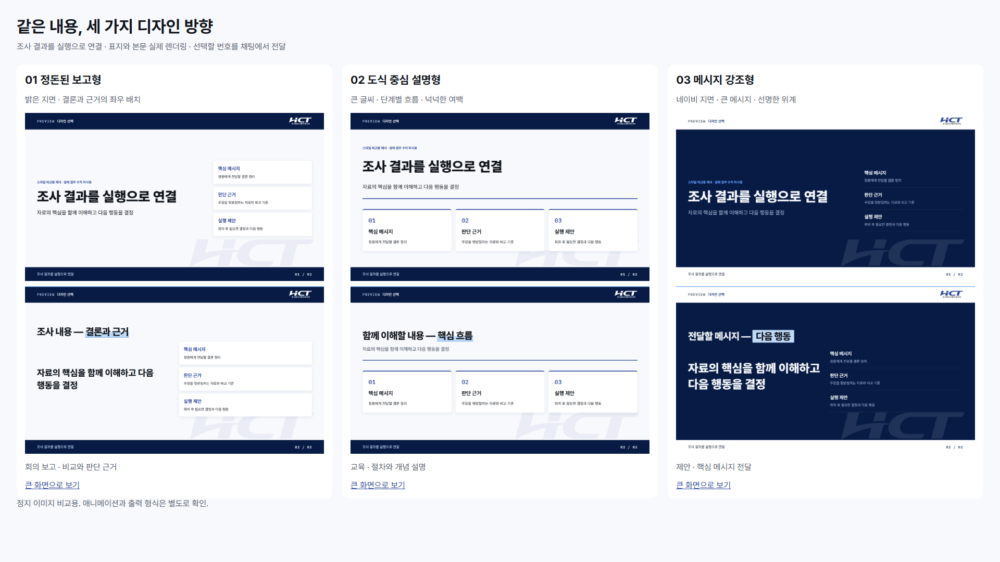

# 이미지로 발표 디자인 고르기

목적·청중·형식을 정한 뒤 같은 내용의 표지와 본문을 세 방향으로 렌더링한다.
스킬 사용자는 이미지와 설명을 보고 선택하면 된다. 아래 입력 파일과 실행 명령은 에이전트·관리자를 위한 것으로, 일반 사용자에게 직접 작성하게 하지 않는다.
다음 이미지는 실제 브라우저에서 생성한 예시이며, 실제 업무 성과나 수치를 사용하지 않았다.



| 번호 | 방향 | 원본 이미지 |
|---|---|---|
| 01 | 정돈된 보고형: 밝은 지면, 결론과 근거의 좌우 배치 | [표지](previews/report-cover.png) · [본문](previews/report-body.png) |
| 02 | 도식 중심 설명형: 큰 글씨, 단계 흐름, 여백 | [표지](previews/explain-cover.png) · [본문](previews/explain-body.png) |
| 03 | 메시지 강조형: 네이비 지면, 큰 메시지, 강한 위계 | [표지](previews/proposal-cover.png) · [본문](previews/proposal-body.png) |

회사 로고·폰트·팔레트·머리말·꼬리말은 공통이다. 번호로 고르거나 원하는 조합·수정 방향을 설명한다.
스킬은 선택 결과를 제작 방향에 반영한 다음 전체 자료를 만든다. 선택을 위임할 수도 있다.

## 자신의 내용으로 생성

JSON의 title, message, points에 실제 제목·메시지·대표 항목 2~3개를 적는다.
입력 예시와 선택 절차는 [스킬의 시각 선택 지침](../.claude/skills/blue-report/references/visual-style-selection.md)에 있다.

저장소 루트에서:

```bash
python .claude/skills/blue-report/scripts/style_previews.py --content brief.json --out decks-out/style-review
```

예시 내용으로 기능을 확인하려면 --content를 생략한다. 기존 선택 자료를 보존하므로 재생성할 때는 새 출력 폴더를 사용한다.
생성 파일은 후보별 표지·본문 PNG 6개, comparison.png, index.html, 개별 HTML, styles.json이다.
파일을 실제로 열고 글자·로고·배치를 확인한 뒤 사용자에게 비교 이미지를 보여준다.

## 효과와 출력 형식

이미지는 정지 화면이다. 애니메이션은 별도로 원하는 정도·클릭/자동 재생 방식을 확인하고 실제 결과에서 검증한다.
이 미리보기는 HTML 렌더링이다. PPTX를 요청하면 선택한 방향의 대표 PPTX 장도 렌더링하고 편집 가능 여부를 확인한다.
추가 AI 이미지 생성 서비스나 유료 API를 호출하지 않는다. 브라우저 렌더링은 로컬에서 실행한다.
